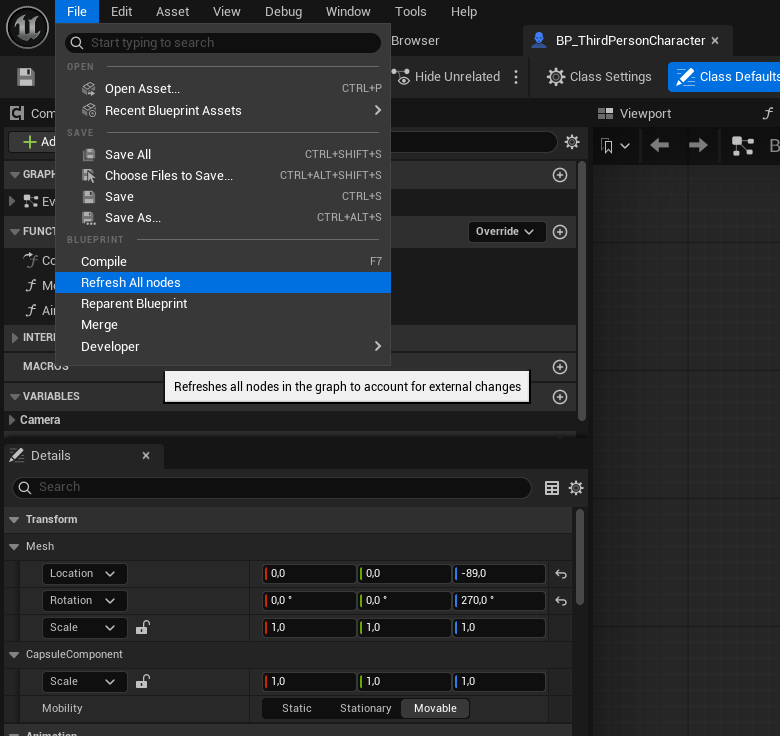
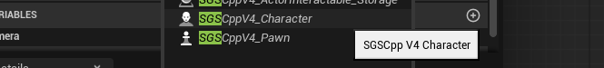
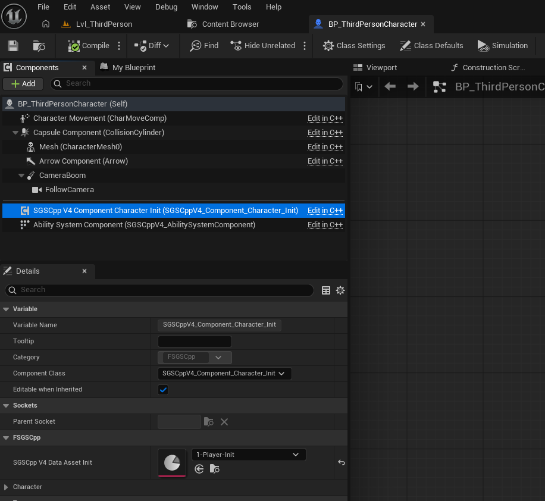

# Sir Gas System | SGS | SGSCpp |

## Documentations

1. [Github - tranek](https://github.com/tranek/GASDocumentation)
2. [epicgames.com](https://dev.epicgames.com/documentation/unreal-engine/gameplay-ability-system-for-unreal-engine?lang=ru)
3. [ActionRPG](https://www.fab.com/listings/ef04a196-03c1-4204-998a-c7d5264fade7) 
4. [ActionRPG on Unreal engine 5](https://github.com/sirotkin76/ActionRPG_UnrealEngine5)
5. [Documentation for working with custom graphs]([https://github.com/sirotkin76/ActionRPG_UnrealEngine5](https://github.com/sirotkin76/SirCppCustomGraphAssetEditor)) 

## Step 1
Copy the plugin folder into your project. This is necessary to ensure that your project does not break when the plugin is updated.

## Step 2
Change your character's parent to a class from the plugin.
 - **SGSCppV4_Character**
 - **SGSCppV4_Pawn**

Choosing a parental archetype for a character

## Step 3
  a. Create a data asset containing character attributes ("**SGSCppV4_DataAsset_Attr_Character_Init**"). In this data asset, you should specify the gameplay abilities and gameplay effects to be used for initialization.
  
  b.  After you changed the character's parent, a new component "**SGSCppV4_Component_Character_Init**" appeared in it. Add a Data Asset containing data to the component's "**SGSCppV4_DataAssetInit**" variable.

News about changes
[Boosty](https://boosty.to/unrealengine4/posts/2064b642-314c-4298-a81e-effe133103de)

